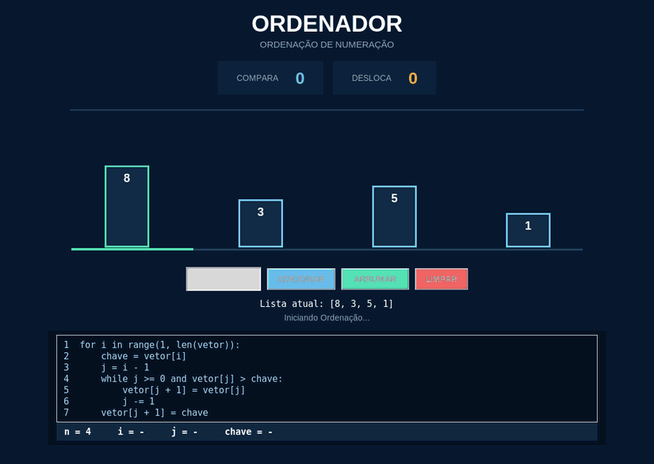

# ORDENADOR — Visualizador de Insertion Sort

Um projeto desenvolvido em **Python** com **Tkinter** para demonstrar, passo a passo, como funciona o algoritmo de ordenação por inserção (*Insertion Sort*).

Em vez de apenas exibir a lista ordenada, o programa mostra as comparações e os deslocamentos por meio de uma animação: uma garra mecânica recolhe o número escolhido, guarda-o em um compartimento, movimenta os outros elementos e o insere na posição correta.

## Preview

<p align="center">
  
</p>

<p align="center"><sub>Exemplo com a lista [8, 3, 5, 1]. A animação demonstra a seleção da chave, os deslocamentos e a lista ordenada.</sub></p>

[Ver captura de tela estática](assets/preview.png)

## O que o projeto faz

- **Adiciona números inteiros** a uma lista, com limite configurável (atualmente, até 10 elementos).
- **Ordena a lista com Insertion Sort**, mostrando cada etapa da execução.
- **Anima uma garra mecânica** que recolhe a chave e a armazena enquanto as demais barras são deslocadas.
- **Destaca visualmente** os elementos em comparação e a parte já ordenada da lista.
- **Exibe os contadores** de comparações e deslocamentos.
- **Mostra o pseudocódigo**, destacando a linha correspondente à etapa em andamento.
- **Atualiza as variáveis** `n`, `i`, `j` e `chave` durante a execução.
- Permite **limpar a lista** e começar uma nova demonstração.

## Tecnologias utilizadas

- **Python** — algoritmo, controle da execução e animações.
- **Tkinter** — interface gráfica e desenho das barras e da garra no `Canvas`.
- **Bibliotecas padrão `math` e `time`** — suavização e temporização dos movimentos.

O projeto não exige a instalação de pacotes externos via `pip`. É necessário apenas ter o Python com suporte ao Tkinter.

## Organização das pastas

```text
ordenador/
├── main.py                  # Ponto de entrada do programa
├── configuracao.py          # Cores, dimensões e velocidade da animação
├── funcoes/
│   ├── __init__.py
│   └── funcoes.py            # Etapas do algoritmo Insertion Sort
├── interface/
│   ├── __init__.py
│   ├── app.py                # Janela, botões, indicadores e pseudocódigo
│   └── gancho.py             # Garra mecânica e animação dos movimentos
├── assets/
│   ├── preview.gif           # Demonstração animada para o GitHub
│   └── preview.png           # Captura de tela
└── README.md
```

### Responsabilidade de cada módulo

| Arquivo | Responsabilidade |
| --- | --- |
| `main.py` | Inicializa a janela Tkinter e a interface com a garra. |
| `configuracao.py` | Centraliza cores, tamanhos, limite de números e intervalo entre etapas. |
| `funcoes/funcoes.py` | Implementa `gerar_passos_ordenacao()`, que fornece os estados sucessivos do Insertion Sort. |
| `interface/app.py` | Cria a interface, lê os valores digitados e apresenta contadores, mensagens e pseudocódigo. |
| `interface/gancho.py` | Estende a interface original com o cabo, o compartimento da chave e os movimentos da garra. |

A divisão mantém a **lógica de ordenação separada da apresentação visual**, facilitando ajustes na animação sem reescrever o algoritmo.

## Como executar

**1.** Tenha o **Python 3** instalado, com suporte ao Tkinter.

**2.** Baixe ou clone este repositório e abra um terminal na pasta do projeto.

**3.** Execute:

```bash
python main.py
```

Em alguns sistemas Linux ou macOS, utilize `python3 main.py`. No Linux, talvez seja necessário instalar o pacote `python3-tk` pelo gerenciador de pacotes da sua distribuição.

> **Importante:** para carregar a versão com animação mecânica, `main.py` deve importar `AppOrdenacaoComGancho` de `interface.gancho` e instanciar essa classe ao criar a janela.

```python
import tkinter as tk
from interface.gancho import AppOrdenacaoComGancho

janela = tk.Tk()
AppOrdenacaoComGancho(janela)
janela.mainloop()
```

## Como utilizar

1. Digite um número inteiro no campo de entrada e clique em **ADICIONAR** (ou pressione **Enter**).
2. Repita até formar a lista que deseja ordenar.
3. Clique em **ARRUMAR** para iniciar a animação.
4. Acompanhe os movimentos da garra, as comparações, os deslocamentos e o pseudocódigo.
5. Ao final, clique em **LIMPAR** para realizar outra demonstração.

### Entendendo a animação

O Insertion Sort percorre a lista a partir do segundo elemento. Em cada passagem, escolhe uma **chave** e compara seu valor com os elementos anteriores.

Na visualização, a garra retira essa chave e a guarda no compartimento. Enquanto ela permanece armazenada, as barras com valores maiores são transportadas para a direita. Quando o espaço correto é encontrado, a chave é inserida nele. O processo continua até toda a lista estar ordenada.

**Exemplo:** `[8, 3, 5, 1]` → `[1, 3, 5, 8]`.

## Objetivo

O projeto foi criado para apoiar o estudo de **algoritmos e estruturas de dados**, tornando mais fácil visualizar o papel da chave, das comparações e dos deslocamentos no Insertion Sort.

---

*Projeto educacional desenvolvido com Python e Tkinter.*
